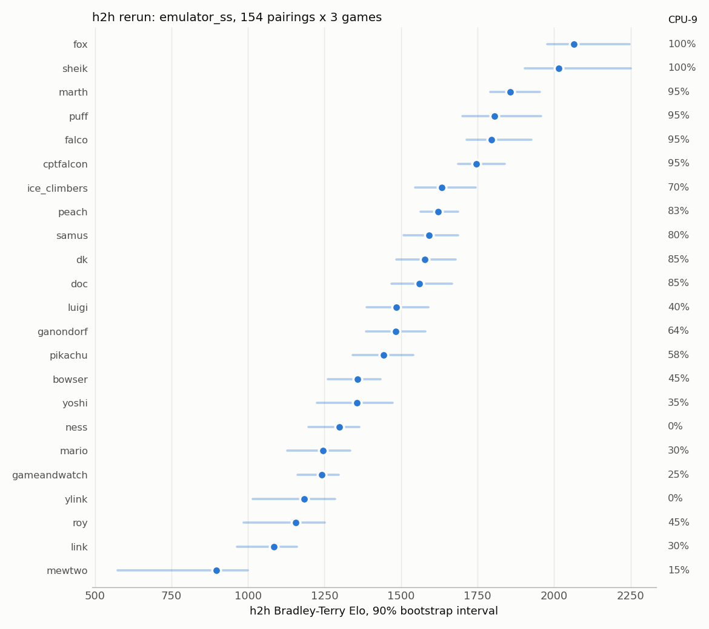

# 2026-10-20 — Cross-character h2h rerun on emulator_ss: results

## TL;DR

The 2026-07-22 rerun of the all-character head-to-head (both fixes: char-select
gate + `emulator_ss` faithful FFW, batched harness `tools/h2h_batch_mp.py`)
finished all **154 scheduled pairings × 3 games = 462 games, 0 draws**. The
point ranking (ρ = 0.92, scatter `eval_results/h2h_vs_cpu9.png`) was computed
on 2026-07-22 but never written into the notes. This note records it and adds
bootstrap intervals, the schedule-confound check, a per-char baseline canary
pass, and a realtime control for the one char that failed it (Doc).

- **The canaries pass** on the rerun replays (`replays_h2h_batched/`): 0
  wrong-character / >2-player replays, center-stick 25–43% for every char, and
  Fox L-cancel 92% (human master baseline 91.6%). One exception: **Doc L-cancels
  67% vs a human-master baseline of 87%**. A realtime control gives the same
  64%, so it is the Doc model, not the emulator — see "Doc" below.
- **h2h Elo tracks CPU-9 win rate: Spearman ρ = 0.92** (bootstrap 90% interval
  0.88–0.94, n=23). The same schedule on the broken stock-FFW build gave
  ρ = −0.07 [−0.20, 0.10] — the retracted "uncorrelated" result.
- Top tier: **fox ≈ sheik** (intervals overlap; sheik won their pairing 2–1),
  then marth / puff / falco / cptfalcon. Bottom: mewtwo, clearly last.

## Validity checks (done before ranking)

`tools/validate_run.py replays_h2h_batched` and `tools/h2h_canary.py`, all 23 chars:

- integrity: >2-player replays 0, same-char-both-ports 0. The char-select fix holds.
- center-stick%: 25–43% for every char (broken pipeline → ~100%).
- L-cancel% against `data/canary_baselines.json` (human master corpus, built
  2026-07-23 for the chars that tripped the absolute bands):

  | char | bot (rerun) | human master | landings/kf bot / human |
  |---|---|---|---|
  | fox | 92% | 91.6% | 3.62 / 4.11 |
  | peach | 64% | 67.6% | 0.57 / 0.60 |
  | mewtwo | 60% | 67.1% (79 landings) | 1.44 / 1.36 |
  | ness | 66% | 73.1% (67 landings) | 2.13 / 3.14 |
  | **doc** | **67%** | **87.4%** | 1.45 / 1.67 |

  Peach, Mewtwo and Ness are within ~7 pt of their (small-n for mewtwo/ness)
  human baselines. Doc is 20 pt below → RED in baseline-relative mode.
  Landings/kf are healthy for all, so this is not the both-bots-mistimed "mush"
  signature from 2026-07-22.

The same schedule was used for both campaigns (the invalid run's 147 pairings
are a subset of the rerun's 154), so the schedule — which was shaped by the
CPU-9 prior order — does not by itself produce the correlation.

## Ranking

Bradley-Terry (`tools/rank_h2h.py eval_results/h2h/rerun_batched`; the tool now
takes the results dir as argv[1] — the old default globbed `eval_results/h2h/**`
recursively, which would mix in `bvf_test/`). Interval = 90% bootstrap,
resampling games within each pairing (300 reps). With 3 games per pairing a
3–0 pairing never varies under resampling, so these intervals **understate**
the real uncertainty.

| rank | char | Elo | 90% int. | rank 90% | h2h win% | games | CPU-9% |
|---|---|---|---|---|---|---|---|
| 1 | fox | 2064 | 1977–2248 | 1–2 | 91 | 33 | 100 |
| 2 | sheik | 2015 | 1904–2251 | 1–3 | 88 | 33 | 100 |
| 3 | marth | 1857 | 1792–1954 | 3–5 | 82 | 66 | 95 |
| 4 | puff | 1805 | 1700–1958 | 3–6 | 79 | 33 | 95 |
| 5 | falco | 1796 | 1714–1926 | 3–6 | 67 | 33 | 95 |
| 6 | cptfalcon | 1747 | 1686–1839 | 4–7 | 69 | 36 | 95 |
| 7 | ice_climbers | 1634 | 1547–1745 | 6–11 | 67 | 36 | 70 |
| 8 | peach | 1621 | 1564–1687 | 7–11 | 62 | 66 | 83 |
| 9 | samus | 1591 | 1508–1687 | 7–12 | 61 | 36 | 80 |
| 10 | dk | 1577 | 1485–1679 | 7–13 | 49 | 39 | 85 |
| 11 | doc | 1560 | 1468–1667 | 7–13 | 56 | 36 | 85 |
| 12 | luigi | 1485 | 1387–1589 | 9–15 | 56 | 36 | 40 |
| 13 | ganondorf | 1482 | 1386–1580 | 10–14 | 47 | 30 | 64 |
| 14 | pikachu | 1443 | 1342–1540 | 11–15 | 55 | 33 | 58 |
| 15 | bowser | 1359 | 1262–1434 | 14–18 | 36 | 66 | 45 |
| 16 | yoshi | 1356 | 1226–1473 | 13–19 | 41 | 39 | 35 |
| 17 | ness | 1298 | 1198–1365 | 15–20 | 30 | 30 | 0 |
| 18 | mario | 1246 | 1128–1334 | 16–21 | 26 | 39 | 30 |
| 19 | gameandwatch | 1241 | 1162–1297 | 17–20 | 26 | 66 | 25 |
| 20 | ylink | 1183 | 1016–1284 | 17–22 | 30 | 27 | 0 |
| 21 | roy | 1156 | 986–1251 | 18–22 | 14 | 36 | 45 |
| 22 | link | 1085 | 964–1161 | 20–22 | 17 | 42 | 30 |
| 23 | mewtwo | 897 | 574–1000 | 23 | 6 | 33 | 15 |

Largest CPU-9 vs h2h disagreements: ness and ylink (0% vs CPU-9, mid-low h2h),
luigi (40% CPU-9, rank 12), roy (45% CPU-9, rank 21). CPU-9 rates are 20–31
games each, so ±10 pt is within their noise.

## Doc

Doc L-cancels well below its human-master baseline (87.4%, 6,966 landings)
under every emulator path tried, all vs `hf_eval/fox-master`:

| run | emulator | games | doc landings | doc L-cancel | fox L-cancel |
|---|---|---|---|---|---|
| batched rerun (all opponents) | `emulator_ss` FFW | 36 | 572 | 67% | — |
| `replays_ffw` (2026-07-23) | FFW, single instance | 14 | 203 | 70% | 88% |
| `replays_doc_rt` (today) | realtime OGL, blocking input | 6 | 107 | 64% | 84% |

Realtime matches FFW, so the gap is the **Doc checkpoint's behavior, not an
emulator/harness defect**. Its h2h rating stands as measured. (Why the Doc BC
model under-L-cancels is open: data volume, per-char step budget, or something
Doc-specific in the landing-lag calibration, not checked.)

Side finding: the first realtime attempt **deadlocked mid-match 3** — Dolphin
stopped writing frames at 7,629 (no game-end event), play.py asleep in a pipe
read, both alive. It followed a "Dropping OutputStream, audio playing through
this stream will stop" line in the Dolphin log; causation not established. The
partial replay was excluded; the 2 complete games were kept and 4 more played
(no recurrence). If it recurs, `--disable-audio` is the first thing to try.

## Files

- results: `eval_results/h2h/rerun_batched/*.json`; replays: `replays_h2h_batched/`
- pairings input: the untracked file `--help` at repo root (the 154-pair JSON
  passed as `--pairings`; saved under that name by accident)
- plot: `eval_results/h2h_rerun_elo.png`
